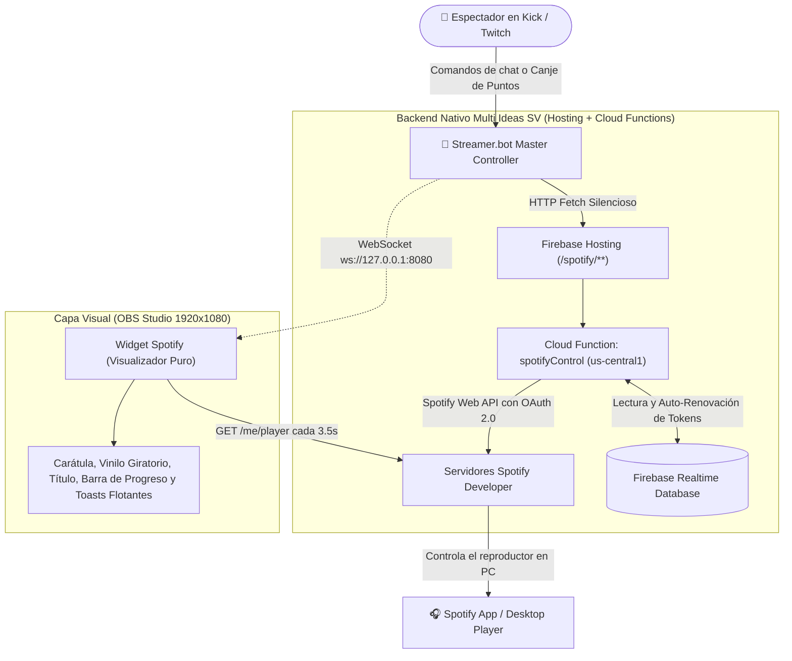

# 🎵 Manual Técnico de Integración: Spotify Developer API + Streamer.bot + Widget OBS Live

Este manual documenta de forma exhaustiva la arquitectura, configuración, endpoints y funcionamiento interno del ecosistema propio de **Spotify** integrado con **Streamer.bot**, **Kick** y el **Widget de OBS Studio** para el canal **Jikokun / Multi Ideas SV**.

---

## 📑 Tabla de Contenidos
1. [Arquitectura General del Ecosistema](#1-arquitectura-general-del-ecosistema)
2. [Catálogo Oficial de Endpoints Nativos de Spotify](#2-catálogo-oficial-de-endpoints-nativos-de-spotify)
3. [Guía de Configuración en Streamer.bot](#3-guía-de-configuración-en-streamerbot)
4. [Manejo Crítico de Variables en Streamer.bot](#4-manejo-crítico-de-variables-en-streamerbot)
5. [Funcionamiento del Widget OBS (`widget_spotify.html`)](#5-funcionamiento-del-widget-obs-widget_spotifyhtml)
6. [Mecanismos de Autocuración y Seguridad (Zero Downtime)](#6-mecanismos-de-autocuración-y-seguridad-zero-downtime)
7. [Guía de Solución de Problemas (Troubleshooting)](#7-guía-de-solución-de-problemas-troubleshooting)

---

## 1. Arquitectura General del Ecosistema

Para evitar depender de servicios de terceros (como MrBoost) y eliminar saltos y colas duplicadas, el sistema implementa una **separación estricta de responsabilidades**:



### Reglas Fundamentales de la Arquitectura:
1. **Streamer.bot es el Controlador Maestro (Single Source of Truth):** Todas las acciones que alteran la reproducción (`add_to_queue`, `skip`, `play`, `pause`) son ejecutadas **únicamente por Streamer.bot** a través de sub-acciones `Fetch URL`.
2. **El Widget de OBS es un Visualizador Puro:** Escucha los mensajes por WebSocket solo para desplegar alertas gráficas (toasts flotantes y chimes de sonido) y refresca la vista visual con `GET /me/player`, pero **nunca envía llamadas modificadoras a Spotify**, erradicando el doble salto o doble encolado.
3. **Persistencia y Auto-Renovación en Servidor:** Los tokens OAuth (`refresh_token` y `access_token`) residen en Firebase Realtime Database bajo la ruta `stream/spotify_auth/{user}` y son renovados automáticamente sin intervención del usuario.

---

## 2. Catálogo Oficial de Endpoints Nativos de Spotify

Todos los enlaces se encuentran alojados en tu propio dominio de Firebase Hosting con enrutamiento limpio a la Cloud Function `spotifyControl`.

* **Dominio Base Oficial:** `https://sensunshopweb.web.app/spotify/`
* **Dominio Alternativo Cloud Function:** `https://us-central1-sensunshopweb.cloudfunctions.net/spotifyControl`

---

### 1. Añadir a la Cola (`add_to_queue.php` / `add_to_queue`)
Busca la pista más relevante en el catálogo global de Spotify y la envía a la cola de reproducción del streamer.

* **Método:** `GET` o `POST`
* **URL:** `https://sensunshopweb.web.app/spotify/add_to_queue.php?user={usuario}&song_name={cancion}&format={formato}`
* **Parámetros:**
  * `user` (requerido): Identificador de cuenta registrada (ej. `jikokun2`).
  * `song_name` (requerido): Texto de búsqueda de la canción (con o sin artista).
  * `format` (opcional):
    * `name` o `title`: Devuelve el **nombre real oficial corregido** (ej. `Donde Estás? de Alex Zurdo`). Ideal para respuestas en chat.
    * `song`: Devuelve solo el título (ej. `Donde Estás?`).
    * `json`: Devuelve objeto JSON estructurado con `song`, `artist`, `title`, `url` y `success`.
    * *(Por defecto)*: `Added to queue: "Título" (Artista)`.

---

### 2. Saltar Canción (`skip.php` / `skip`)
Pasa instantáneamente a la siguiente canción en la lista de Spotify.

* **Método:** `GET` o `POST`
* **URL:** `https://sensunshopweb.web.app/spotify/skip.php?user={usuario}`
* **Parámetros:**
  * `user` (requerido): Identificador de cuenta (ej. `jikokun2`).
* **Protección integrada:** Cooldown atómico de **2.5 segundos** en servidor. Si se reciben 2 llamadas consecutivas en menos de 2.5s, la segunda es suprimida para asegurar que solo salte una única pista.
* **Respuesta:** `200 OK` &rarr; `Song Skipped!`

---

### 3. Reanudar Música (`play.php` / `play`)
Reanuda la reproducción si Spotify se encuentra en pausa.

* **Método:** `GET` o `POST`
* **URL:** `https://sensunshopweb.web.app/spotify/play.php?user={usuario}`
* **Respuesta:** `200 OK` &rarr; `Spotify playback resumed.`

---

### 4. Pausar Música (`pause.php` / `pause`)
Detiene temporalmente la reproducción de Spotify.

* **Método:** `GET` o `POST`
* **URL:** `https://sensunshopweb.web.app/spotify/pause.php?user={usuario}`
* **Respuesta:** `200 OK` &rarr; `Spotify playback paused.`

---

### 5. Canción Actual (`song.php` / `song` / `cancion.php`)
Consulta en tiempo real qué pista está sonando en el dispositivo activo y devuelve su nombre formateado y enlace público de Spotify.

* **Método:** `GET`
* **URL:** `https://sensunshopweb.web.app/spotify/song.php?user={usuario}&format={formato}`
* **Parámetros:**
  * `format` (opcional):
    * *(Por defecto)*: `🎶 Sonando ahora: Título de Artista 🔗 https://open.spotify.com/track/...`
    * `url`: Devuelve únicamente el enlace directo de Spotify.
    * `name` / `title`: Devuelve solo `Título - Artista`.
    * `json`: Devuelve JSON con `{ is_playing, song, artist, title, url, formatted }`.
* **Si Spotify está cerrado o inactivo:** Devuelve amablemente: `No hay ninguna canción reproduciéndose actualmente en Spotify.`

---

### 6. Sincronización Manual de Tokens (`save_token`)
Utilizado por el panel de laboratorio ([prueba.html](file:///e:/Proyectos%20Web/multi-ideas-sv/prueba.html)) para sincronizar los tokens OAuth con Firebase.

* **URL:** `https://sensunshopweb.web.app/spotify/save_token?user={usuario}&access_token={token}&refresh_token={refresh}`

---

### 7. Proxy de Renovación (`refresh_token`)
Renueva el token de acceso del widget de OBS sin exponer el Client Secret en el navegador.

* **URL:** `https://sensunshopweb.web.app/spotify/refresh_token?user={usuario}&refresh_token={refresh}`

---

## 3. Guía de Configuración en Streamer.bot

A continuación se detalla la configuración exacta de cada Acción y Sub-Acción en **Streamer.bot**:

### A. Recompensa de Puntos de Kick / Reclamo ("Pide tu canción")
* **Trigger:** `Kick > Channel Reward > Reward Redemption` (Criterio: `Pide tu canción`).
* **Sub-Acciones requeridas:**
  1. `Core > Network > Fetch URL`:
     * **URI:** `https://sensunshopweb.web.app/spotify/add_to_queue.php?user=jikokun2&song_name=%rawInputUrlEncoded%&format=name`
     * **Variable Name:** `respuestaSpotify`
     * **Parse Results as JSON:** *Desmarcado*
  2. `Kick > Chat > Send Message to Channel`:
     * **Message:** `@%user% acaba de pedir "%respuestaSpotify%". 🎶 ¡Añadida a la cola con éxito, ponte cómodo que ya casi suena!`

---

### B. Comando de Chat `!addsong` (o `!cancion`)
* **Trigger:** `Core > Commands > Command Triggered` (Comando: `!addsong`).
* **Sub-Acciones:**
  1. `Core > Network > Fetch URL`:
     * **URI:** `https://sensunshopweb.web.app/spotify/add_to_queue.php?user=jikokun2&song_name=%rawInputUrlEncoded%&format=name`
     * **Variable Name:** `respuestaSpotify`
  2. `Kick > Chat > Send Message to Channel`:
     * **Message:** `@%user% ha solicitado "%respuestaSpotify%". 🎶 ¡Encolada correctamente!`

---

### C. Comando de Chat `!skipsong` (o `!skip`)
* **Trigger:** `Core > Commands > Command Triggered` (Comando: `!skipsong`).
* **Permisos recomendados:** Solo Moderadores y Broadcaster.
* **Sub-Acciones:**
  1. `Core > Network > Fetch URL`:
     * **URI:** `https://sensunshopweb.web.app/spotify/skip.php?user=jikokun2`
     * **Variable Name:** `respuestaSpotify`
  2. `Kick > Chat > Send Message to Channel`:
     * **Message:** `⏭️ @%user% ha saltado la canción actual en Spotify.`

---

### D. Comando de Chat `!song` (o `!cancion`)
* **Trigger:** `Core > Commands > Command Triggered` (Comando: `!song`).
* **Sub-Acciones:**
  1. `Core > Network > Fetch URL`:
     * **URI:** `https://sensunshopweb.web.app/spotify/song.php?user=jikokun2`
     * **Variable Name:** `respuestaSpotify`
  2. `Kick > Chat > Send Message to Channel`:
     * **Message:** `%respuestaSpotify%`

---

### E. Comandos `!play` y `!pause`
* **Acción Play (`!play`):**
  * `Fetch URL`: `https://sensunshopweb.web.app/spotify/play.php?user=jikokun2`
  * Variable Name: `respuestaSpotify`
  * Kick Message: `▶️ @%user% ha reanudado la música.`
* **Acción Pause (`!pause` / `!pausa`):**
  * `Fetch URL`: `https://sensunshopweb.web.app/spotify/pause.php?user=jikokun2`
  * Variable Name: `respuestaSpotify`
  * Kick Message: `⏸️ @%user% ha pausado la música.`

---

## 4. Manejo Crítico de Variables en Streamer.bot

> [!IMPORTANT]
> **Streamer.bot es 100% Sensible a Mayúsculas y Minúsculas (Case-Sensitive)**: Si escribes `%rawinput%` en lugar de `%rawInput%`, Streamer.bot no reconocerá la variable y enviará el texto vacío o literal.

### Tabla de Variables de Entrada:
| Variable en Streamer.bot | Cuándo Usarla | Ejemplo de Salida |
| :--- | :--- | :--- |
| **`%rawInputUrlEncoded%`** | **Obligatoria para enlaces `Fetch URL`** (convierte espacios y acentos en caracteres válidos para la web). | `Donde+estas+by+Alex+Zurdo` |
| **`%rawInput%`** | Para mensajes de chat directos en Kick o Twitch. | `Donde estas by Alex Zurdo` |
| **`%user%`** | Nombre del espectador que ejecutó la acción. | `Jikokun` |
| **`%respuestaSpotify%`** | Variable configurada en el Fetch que almacena lo que devuelve el servidor. | `Donde Estás? de Alex Zurdo` |

---

## 5. Funcionamiento del Widget OBS (`widget_spotify.html`)

El widget ubicado en `mini_widgets/widget_spotify.html` ha sido optimizado como un **escenario nativo 1920x1080**:

* **URL recomendada para OBS Studio:**
  ```text
  http://localhost:8089/mini_widgets/widget_spotify.html?theme=aqua&pos=bottom-left&user=jikokun2
  ```
  *(o la URL de tu hosting web).*
* **Resolución en OBS Browser Source:** Ancho: `1920` | Alto: `1080`.
* **Características:**
  * **Auto-Escalado:** Mantiene proporciones perfectas en cualquier resolución de pantalla mediante `resizeStage()`.
  * **Arrastre y Posicionamiento:** Puedes arrastrar el widget con el ratón a cualquier cuadrante en OBS y pulsar el botón 🔒 para fijar las coordenadas (se guardan en `localStorage`).
  * **Conexión WebSocket dual:** Se conecta a Streamer.bot en `ws://127.0.0.1:8080/` (o puerto `4445`) suscrito a eventos `Kick: ChatMessage`.
  * **Banner Flotante `!cancion`:** Si un usuario escribe `!cancion` sin parámetros en el chat, despliega un panel estilizado en la esquina inferior derecha por 7 segundos con los datos del tema.

---

## 6. Mecanismos de Autocuración y Seguridad (Zero Downtime)

Para evitar que el stream se quede sin música o presente errores durante transmisiones largas:

1. **Auto-Recuperación de Error 401 (Self-Healing Token Refresh):**
   * Cuando la Cloud Function realiza peticiones a Spotify (`/search`, `/queue`, `/next`, `/currently-playing`), si Spotify responde con código `401 Unauthorized` (token expirado), la función automáticamente:
     1. Extrae el `refresh_token` guardado en Realtime Database.
     2. Solicita un nuevo `access_token` fresco a `accounts.spotify.com/api/token` con el Client Secret.
     3. Actualiza Realtime Database con el nuevo token y expiración.
     4. Reintenta la operación original de Spotify de manera totalmente transparente.
2. **Candado Anti-Doble Salto (Server-Side Debounce):**
   * Impide saltar dos canciones seguidas si Streamer.bot o el chat disparan dos eventos en menos de 2.5 segundos.
3. **Deduplicación de Cola:**
   * Si la misma pista (mismo URI de Spotify) se solicita dos veces en menos de 4 segundos, el servidor la procesa con éxito pero descarta la segunda llamada a la API para no saturar la lista de reproducción.

---

## 7. Guía de Solución de Problemas (Troubleshooting)

### Problema 1: "No song found" o código 400 al añadir canción
* **Causa:** El espectador envió caracteres especiales o espacios y el Fetch usaba `%rawInput%` en lugar de `%rawInputUrlEncoded%`.
* **Solución:** Revisa tu Fetch URL en Streamer.bot y confirma que tenga `song_name=%rawInputUrlEncoded%`.

### Problema 2: "Device inactive" o código 403 / 404 de Spotify
* **Causa:** Spotify no está reproduciendo música activamente en la computadora o el dispositivo entró en modo de suspensión.
* **Solución:** Abre la aplicación de Spotify en tu PC y dale Play a cualquier canción para que tu dispositivo se active como "Reproductor Principal".

### Problema 3: Al canjear puntos de canal no se añade nada
* **Causa:** En el panel de creador de Kick, la recompensa no tiene marcada la casilla de requerir texto.
* **Solución:** Ve a Kick &rarr; Puntos de Canal &rarr; Edita la recompensa "Pide tu canción" y marca la opción **"Requerir que el usuario introduzca texto"** (*Require user input*).

### Problema 4: Error en el campo "Variable Name" (borde rojo en Streamer.bot)
* **Causa:** Streamer.bot no permite dejar el nombre de la variable vacío en la sub-acción Fetch URL.
* **Solución:** Escribe cualquier nombre, por ejemplo: `respuestaSpotify`.

---

*Manual generado para uso interno del equipo de desarrollo y administración de streaming de Multi Ideas SV.*
